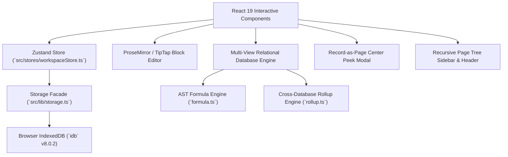

# Architecture & Data Model: Personal Notion Alternative

## 1. System Overview

Worknest (*NovaNotes*) is an offline-first, client-rendered personal workspace platform built with React 19, Next.js 15 App Router, Tailwind CSS, Zustand, and browser-native IndexedDB.



---

## 2. Normalized Data Model

### 2.1 Workspaces
```typescript
interface Workspace {
  id: string;
  name: string;
  icon: string;
  ownerId: string;
  members: UserProfile[];
  createdAt: number;
  updatedAt: number;
}
```

### 2.2 Hierarchical Pages
```typescript
interface Page {
  id: string;
  workspaceId: string;
  parentId: string | null; // Enables recursive tree structures
  title: string;
  icon: string | null;     // Emoji icon
  coverImage: string | null; // Banner cover URL or preset
  isFavorite: boolean;
  isArchived: boolean;     // Soft-deletion / Trash
  type: 'doc' | 'database';
  content?: any;           // TipTap ProseMirror document schema JSON
  comments?: PageComment[];
  order: number;
  createdAt: number;
  updatedAt: number;
}
```

### 2.3 Databases & Relational Structure
```typescript
interface Database {
  id: string;
  pageId: string;          // Direct containment reference to parent Page
  title: string;
  properties: DatabaseProperty[];
  views: DatabaseView[];
  records: DatabaseRecord[];
  createdAt: number;
  updatedAt: number;
}

interface DatabaseProperty {
  id: string;
  name: string;
  type: PropertyType; // title | text | number | select | multi_select | status | date | checkbox | url | email | phone | person | formula | relation | rollup | created_time | last_edited_time
  options?: SelectOption[];
  formulaExpression?: string;
  relationDatabaseId?: string;
  relationPropertyId?: string;
  rollupRelationId?: string;
  rollupPropertyId?: string;
  rollupFunction?: RollupFunction;
}

interface DatabaseRecord {
  id: string;
  pageId?: string;         // Enables every record to function as a rich document page
  values: Record<string, any>;
  createdAt: number;
  updatedAt: number;
}
```

---

## 3. Storage & Synchronization Architecture

1. **Local Durability**: All mutations (pages, databases, records, comments, settings) are persisted directly to IndexedDB via transactional stores (`workspaces`, `pages`, `databases`, `preferences`).
2. **In-Memory Reactivity**: Zustand maintains normalized fast-lookup dictionaries (`Record<string, Page>`, `Record<string, Database>`) for instantaneous UI updates without network latency.
3. **Optimistic Updates & Save State**: Mutations update memory immediately and schedule debounced writes with visual indicators (`saved`, `saving`, `offline`, `error`).
4. **Data Ownership & Portability**: Complete workspace JSON backup export and restore, Markdown export/import, and CSV spreadsheet export give users full sovereignty over their data.
