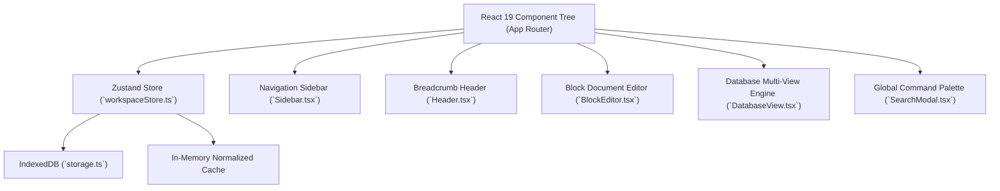

# Architecture Audit: Personal Notion Alternative (NovaNotes)

## 1. Executive Summary & Stack Assessment
This document audits the architecture, tech stack, data pipeline, and runtime state of the personal Notion alternative application.

### Identified Tech Stack
- **Framework**: Next.js 15.1.7 (React 19.0.0, App Router, SSR/Static Prerendering + Client SPA hybrid).
- **Language**: TypeScript 5.7.3 in strict mode (`tsc --noEmit` verified).
- **Styling & Design System**: Tailwind CSS 3.4.17 with CSS custom properties matching Notion light and dark mode palettes (`--background`, `--sidebar`, `--border`, `--muted`, `--accent`).
- **Editor Engine**: TipTap 2.11.5 / ProseMirror with custom nodes:
  - `@tiptap/starter-kit` (Paragraph, Headings 1-3, Blockquote, HorizontalRule, Code, Bold, Italic, Strike)
  - `@tiptap/extension-task-list` & `@tiptap/extension-task-item` (interactive checklists)
  - `@tiptap/extension-code-block-lowlight` with `lowlight` common languages (syntax highlighting)
  - `@tiptap/extension-highlight`, `@tiptap/extension-underline`, `@tiptap/extension-link`, `@tiptap/extension-image`
  - Custom `Callout` node (`src/components/editor/extensions/Callout.ts`)
  - Custom `Toggle` node (`src/components/editor/extensions/Toggle.ts`)
- **State Management**: Zustand 5.0.3 (`src/stores/workspaceStore.ts`) providing reactive in-memory state with debounced write buffers.
- **Persistence Layer**: Browser `IndexedDB` via `idb` 8.0.2 with stores:
  - `workspaces`: workspace metadata, memberships, timestamps.
  - `pages`: hierarchical documents and database containers with indexes `by-workspace` and `by-parent`.
  - `databases`: structured collection schemas, properties, views, and row records.
  - `preferences`: user settings, local LRU items, active theme.
- **Testing**: Vitest 5.0.4 with `jsdom` and `@testing-library/react`.

---

## 2. Diagnostics of Startup & Runtime State
- **Previous Failure**: Webpack chunk missing error (`Cannot find module './403.js'`, `GET /sw.js 500`) caused by running `next build` concurrently while `next dev` was active on port 3000.
- **Remediation**: Terminated orphaned node processes, cleaned `.next/` cache directory, and restarted dev daemon.
- **Current Runtime Status**: Verified operational on `http://localhost:3000` returning `HTTP 200 OK`. Automated test suite passing 7/7 tests in `tests/workspace.test.ts`.

---

## 3. Data Model & Architecture Review

### Evaluation of Database Architecture
- **Current Capability**:
  - Unified records shared across Table, Board (Kanban), Calendar, Gallery, and List views.
  - Property types: Title, Text, Number, Select, Status, Date, Person, Checkbox, URL.
  - Status-based Kanban grouping and column counters.
  - Date-based Calendar rendering.
  - CSV spreadsheet export.
- **Identified Gaps to Address in Phase P3**:
  1. Safe formula evaluation engine without `eval()`.
  2. Relations between databases and derived Rollups.
  3. Timeline (Gantt) view with date spans.
  4. Advanced AND/OR nested filter expressions.
  5. Multi-column calculation summaries (Sum, Average, Min, Max, Count).
  6. Discussion comments thread on pages.
